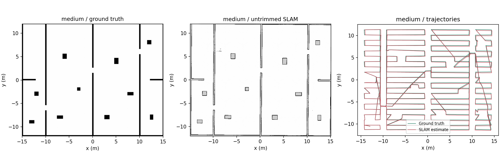

# SLAM / Navigation Simulation Benchmark

面向 **Ubuntu 22.04 / WSL2、ROS 2 Humble、Gazebo Classic 11** 的机器人建图与导航仿真评测平台。

当前 `main` 是本次平台的完整源码快照，已替换之前的 SW01/FAST-LIO 工程。**本版本实际验证的是 SLAM Toolbox + AMCL + Nav2，不是 FAST-LIO2 实装版本。**

> **定位：可复现的仿真评测平台，不是生产级自主导航方案。**
> 三环境建图、8 组 / 40 次导航尝试和 33 项回归已有实测记录，但导航并非全部成功。complex 窄迷宫没有完整覆盖；medium 默认导航配置成功率较低。工作范围验收通过，不代表全环境覆盖、真实足式动力学或所有算法能力已经完成。



## 现在能做到什么

| 能力 | 当前状态 |
|---|---|
| 模型加载 | 通用轮足 `wheeled_quadruped`、足式 `quadruped`、宇树开源 `go2w`、独立通用 `agv` |
| 仿真环境 | `simple`、`medium`、`complex`，包含 GT 栅格；后两者有实际运动的动态障碍 |
| 传感器 | 3D LiDAR、IMU、RGB-D；点云转 LaserScan；点云多稀疏度输出 |
| 阶段 A | SLAM Toolbox 建图、GT 辅助确定性安全覆盖路径、绕墙连接、存图、地图评分与选图 |
| 阶段 B | 冻结地图、AMCL 定位、固定目标序列；NavFn / SMAC 2D / SMAC Hybrid 与 DWB / MPPI / RPP 组合评测 |
| 指标 | 目标状态、覆盖率、容差精确率、场外占据比例、ATE/RPE、跟踪误差、接触事件、控制平滑度、路径效率 |
| 结果可信度 | 真实消息就绪检测、失败停止、超时取消、原子落盘、最终目标刷新确认、全量汇总、冻结地图哈希 |
| 可视化 | Gazebo / RViz，以及离线地图、轨迹、指标图表 |

机器人由理想平面运动插件驱动，腿和轮在评测模式下固定，不仿真实际步态或轮电机动力学。四类模型均有实际加载与运动约束证据，AGV、足式、Go2W 另有导航目标验收。

## 已知缺陷与边界

1. **complex 全图未建全。** 本次全 GT 自由空间覆盖率为 69.89%，左侧窄迷宫不在声明的保守可原地转向工作区中。工作区覆盖 100% 不等于全图覆盖 100%，也不是严格 SE(2) 不可达性证明。
2. **medium 导航不可靠。** 两组默认组合均仅 1/5 成功，有门洞附近超时、规划/恢复失败和持续接触，不能作为生产部署参数。
3. **复杂环境仍有 SLAM 偏移。** complex 原始 ATE 约 0.512m、最大瞬时误差约 2.2m，不能宣传全程厘米级精度。
4. **MPPI 并不保证更好。** 本次 simple 为 2/5、complex 为 3/5；日志出现起点进入致命代价区及恢复失败。尚未通过控制变量实验拆分定位、footprint、动态障碍和控制器参数的各自影响。
5. **没有 M20 Pro 原厂模型。** 没有用猜测尺寸的模型冒充原厂 URDF。AGV 是通用自建模型，不代表认证车辆。
6. **没有实装验证 FAST-LIO / LIO-SAM / RTAB-Map。** 这些只保留适配入口，缺包会明确报错。Livox/MID360 插件也不是默认依赖。
7. **不是自主探索。** 阶段 A 路径使用 GT 地图进行受控覆盖测试；默认里程计来自 Gazebo 真值，不能把本次 ATE 当成独立 LIO 性能。
8. **统计范围有限。** 每组一个 repeat、五个连续目标；较早失败会改变后续实际起点。平均尝试耗时包含失败，不能把“失败更快”解释为导航更优，也不能跨世界直接排名。
9. **部分历史工具危险。** `clean_sim.sh`、`cleanup_sim.sh`、旧 `check_*` / `quick_*` shell 工具含全局进程清理，仅供阅读后单独调试。不要在其他 ROS/Gazebo 实验运行时执行。推荐下文的 `review_*` 工具和正式 runner。
10. **技术栈较旧。** Gazebo Classic 已停止维护；本仓库针对 Humble / Classic 11，未验证迁移到新版 Gazebo 或 ROS 2 Jazzy。

## 实测结果（2026-09-11）

阶段 A 未使用轨迹包围盒裁剪：

| 世界 | 路点完成 | 全 GT 自由空间覆盖 | 声明工作区覆盖 | 10cm 容差精确率 | 场外占据比例 | 原始 / 对齐 ATE |
|---|---:|---:|---:|---:|---:|---:|
| simple | 95/95 | 100% | 100% | 96.81% | 0% | 0.0645 / 0.0114m |
| medium | 242/242 | 100% | 100% | 71.84% | 3.44% | 0.1371 / 0.0221m |
| complex | 65/65 | 69.89% | 100% | 70.45% | 0% | 0.5118 / 0.4922m |

正式导航 40 次尝试：**27 成功、11 ABORTED、2 TIMEOUT**。全部成功目标的实际 GT 位置误差不超过 0.396m。

| 世界 | 全局规划器 + 控制器 | 成功/尝试 | 平均尝试耗时（仿真秒） | 持续接触次数 |
|---|---|---:|---:|---:|
| simple | SMAC 2D + DWB | 5/5 | 15.04 | 0 |
| simple | NavFn + DWB | 5/5 | 14.92 | 0 |
| simple | SMAC Hybrid + MPPI | 2/5 | 22.20 | 0 |
| simple | SMAC 2D + RPP | 5/5 | 9.28 | 0 |
| medium | SMAC 2D + DWB | 1/5 | 107.82 | 4 |
| medium | SMAC Hybrid + MPPI | 1/5 | 40.72 | 3 |
| complex | SMAC 2D + DWB | 5/5 | 23.18 | 0 |
| complex | SMAC Hybrid + MPPI | 3/5 | 23.56 | 2 |

持续接触按 Gazebo 接触事件去抖，排除地面和自身接触，不等同于每一个瞬时接触点。RPP 在本次 simple 任务更快，但没有本次 medium/complex 的 RPP 对照，不能外推。

验证摘要、地图和图表见 [docs/validation](docs/validation/README.md)。这些是历史实测材料，不会伪装成新克隆工作区的本次运行结果。

## 安装与构建

### 1. 环境

- Ubuntu 22.04，或启用 WSL2 的 Ubuntu 22.04；GUI 需要 WSLg / 可用显示服务。
- 已安装 [ROS 2 Humble](https://docs.ros.org/en/humble/Installation/Ubuntu-Install-Debs.html)。
- 使用系统 Python 3.10；建议把仓库放在 WSL Linux 文件系统，不要混用 Conda 的 Python/CMake。
- 运行中推荐 Cyclone DDS；本机 Fast DDS 曾出现生命周期服务响应丢失。

### 2. 克隆、安装依赖、构建

以下命令在 Ubuntu / WSL bash 执行；仓库根目录本身就是 colcon 工作空间，无需额外创建 `sim_ws` 子目录。

```bash
git clone https://github.com/bernardleex526/slam_nav_sim.git
cd slam_nav_sim
bash install_deps.sh
bash build.sh
source install/setup.bash
export RMW_IMPLEMENTATION=rmw_cyclonedds_cpp
```

`install_deps.sh` 使用 sudo 安装核心 apt 依赖，不安装 ROS 软件源、不修改镜像或 shell profile，也不安装未验证的可选建图算法。已有依赖时无需重复执行。`build.sh --clean` 会删除本工作空间的 build/install/log，谨慎使用。

新终端均需：

```bash
cd /path/to/slam_nav_sim
set +u
source /opt/ros/humble/setup.bash
source install/setup.bash
export RMW_IMPLEMENTATION=rmw_cyclonedds_cpp
```

ROS setup 脚本可能读取尚未定义的变量，不要在 `set -u` 下直接 source。

## 使用方法

### 加载模型和世界

```bash
ros2 launch sim_bringup sim.launch.py \
  robot:=agv world:=simple mapping:=none navigation:=none \
  use_gimbal:=false headless:=true viz:=false
```

`robot` 可换为 `wheeled_quadruped`、`quadruped`、`go2w`；`world` 可换为 `medium`、`complex`。查看 Gazebo / RViz 时使用 `headless:=false viz:=true`。Ctrl+C 结束当前 launch。

### 使用仓库示例地图导航

先停止上一套仿真。在仓库根目录启动轮足机器人和 AMCL/Nav2：

```bash
ros2 launch sim_bringup sim.launch.py \
  robot:=wheeled_quadruped world:=simple \
  mapping:=none navigation:=nav2 localization:=amcl \
  map:="$PWD/docs/validation/maps/simple/map.yaml" \
  global_planner:=smac_2d local_planner:=dwb \
  use_gimbal:=false headless:=true viz:=false metrics:=true \
  run_name:=manual_simple
```

新终端加载同一环境，待导航生命周期激活后发送目标：

```bash
ros2 action send_goal /navigate_to_pose nav2_msgs/action/NavigateToPose \
  '{pose: {header: {frame_id: map}, pose: {position: {x: 0.35, y: -6.25, z: 0.0}, orientation: {w: 1.0}}}}'
```

示例地图仅用于快速体验，不证明你这次运行已完成阶段 A。手动运行指标默认在 `~/.ros/sim_eval/manual_simple`。

### 阶段 A：生成自己的地图

```bash
python3 -u src/sim_benchmark/scripts/stage_a_runner.py \
  --config src/sim_benchmark/config/delivery_stage_a.yaml
```

单世界可追加 `--only simple` / `--only medium` / `--only complex`。正式配置固定轮足模型、0.5m/s、1.2m 扫描间距、关闭云台、保存未裁剪地图。结果在 `~/.ros/sim_delivery_stage_a`。

```bash
python3 tools/resummarize_stage_a.py \
  --config src/sim_benchmark/config/delivery_stage_a.yaml
```

汇总生成 `stage_a_selected.yaml`、`stage_a_summary.csv`、`stage_a_results.json`；超时、跳点或中断不算完成。再次运行同名实验会归档已有产物，不会把旧地图当作新结果。

### 阶段 B：8 组导航横比

阶段 A 必须已生成三个世界的有效选择结果：

```bash
python3 -u src/sim_benchmark/scripts/stage_b_runner.py \
  --config src/sim_benchmark/config/delivery_stage_b.yaml
```

可追加 `--only simple` 等过滤世界；`--dry-run` 只查看计划。每组 5 个连续目标、单目标 150 秒上限、固定 seed、同世界冻结地图。结果在 `~/.ros/sim_delivery_stage_b`，包含目标状态、metrics、轨迹、日志及地图副本。

### 从头运行完整评测并验收

```bash
bash tools/run_delivery.sh
python3 tools/verify_delivery.py
python3 tools/build_delivery_report.py --output "$PWD/outputs/latest"
```

完整矩阵可能超过一小时，不是单元测试。脚本默认使用独立 ROS 域 96 / Gazebo 端口 11396；不要同时在同域或端口启动其他仿真。手动并行时须同时隔离 `ROS_DOMAIN_ID`、`GAZEBO_MASTER_URI`，且不得并发写入同名实验目录。

验收分别输出：

- `passed`：声明安全工作区内，地图、40 次尝试、指标、冻结地图/目标一致性与成功目标 GT 误差满足门槛。
- `full_environment_coverage_passed`：三环境全 GT 自由空间覆盖是否都达到 85%。本次为 **false**。

地图门槛为工作区覆盖至少 95%、10cm 容差精确率至少 70%、场外占据比例小于 30%；成功目标 GT 误差不超过 0.5m。定义见 [DELIVERY_SCOPE.md](DELIVERY_SCOPE.md)。**平台验收不要求每种算法所有目标成功，但必须如实保存失败。**

## 测试

已构建并 source 当前工作空间后：

```bash
python3 -m unittest discover -s tools -p 'test_*.py'
```

无 Gazebo 的自动回归历史结果为 33 项通过。额外的实机仿真接口检查需单独运行，不能与同域仿真并行：

```bash
python3 tools/review_planar_smoke.py --robot go2w
python3 tools/review_contact_smoke.py
python3 tools/review_dynamic_smoke.py
python3 tools/review_mapping_smoke.py
```

`review_mapping_smoke.py` 约 45 秒探索后主动结束，只验证建图/存图/评测链路，其 `EXPLORATION_INCOMPLETE` 是预期状态，不能当正式全图验收。`review_robot_navigation.py` 依赖你自己的阶段 A simple 选择结果。

## 目录结构

```text
src/
  robot_descriptions/   # 四类模型、传感器、平面约束/接触插件
  go2w_description/     # Unitree 开源资产与 BSD 许可证
  sim_worlds/          # 三世界、GT 地图、动态障碍驱动
  mapping_adapters/    # SLAM 与点云/扫描适配
  nav2_config/         # 参数合成、规划器与控制器配置
  sim_bringup/         # 统一 launch
  sim_benchmark/       # 阶段 A/B runner 和实验矩阵
  sim_metrics/         # 在线采集与离线评估
  sim_viz/             # RViz 配置
  robot_interface_spec/# 接口约定
tools/                 # 回归、验收、诊断和报告工具
docs/validation/       # 本次精简实测材料及示例地图
```

## 常见问题

- **没有 `/scan`、`/map` 或 AMCL TF**：先检查完整 launch 日志中的 ERROR / FATAL，不要只看末尾；确认所有终端的 ROS 域、DDS 实现一致。
- **服务调用超时**：使用 `rmw_cyclonedds_cpp`，停止当前自己启动的进程后重新启动；不要靠等待固定秒数就宣称 ready。
- **Go2W 网格不可见**：确认已构建/source 本工作空间；启动入口会设置已安装包的网格搜索路径。
- **混入旧节点**：检查 `ps` 和正在使用的域/端口，只结束本次实验进程。不要盲目执行全局 `pkill` 工具。
- **地图评分低但形状看似接近**：GT 为实心障碍，激光图通常是表面线；同时看容差精确率、轨迹误差和未裁剪图，不要仅用裸 recall，也不要断言差距全由墙厚造成。
- **Nav2 goal ABORTED/TIMEOUT**：这是待分析结果；查看代价地图、GT 终点误差、接触记录、恢复日志，不能与基础设施启动失败混为一谈。

## 许可证

平台自有 ROS 包沿用其 `package.xml` 声明的 [Apache-2.0](LICENSE)。Go2W 原始描述资产属于 Unitree，遵循其 [BSD-3-Clause](src/go2w_description/LICENSE)。详见 [第三方声明](THIRD_PARTY_NOTICES.md)。
