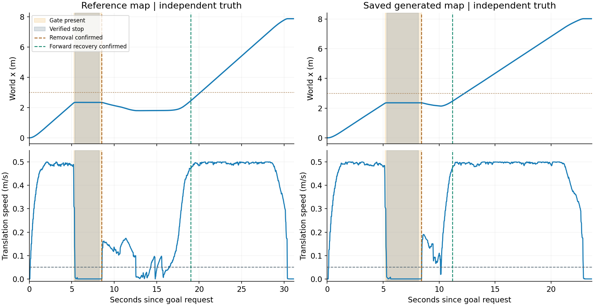

# 临时阻挡恢复修复验证

2026-11-16，v0.1.3。原两项临时阻挡失败：**已修复**；本轮导航契约：**通过**。

本轮锁定 `ros2-demo-005` 的原生成地图，与参考地图重新执行导航对照；这是用户原两项失败的相同地图输入。**本轮未重新建图**。生成图 PGM SHA256 为 `ac287241f03a8dfd04ec2b5b98c8b6584fa2539bcd42c417ad72924b2d37fbd8`，复制后字节完全一致。

[图形汇总](../results/block-recovery-index.html) · [完整实跑报告](../results/block-recovery-final-004/report.html) · [原始导航结果](../results/block-recovery-final-004/navigation-comparison.json) · [独立复算](../results/block-recovery-audit.json)

## 实际受阻、移除与恢复

以下时刻以各阶段目标请求为零点。受阻由独立 Gazebo 真值速度与位置核验；移除记录服务请求／确认区间；恢复必须使用移除后的新样本，并向目标前进至少 0.1 米。

| 地图 | 连续受阻 s | 移除确认 s | 前进恢复确认 s | 完全穿闸 s | 结论 |
|---|---|---|---|---|---|
| 参考 | 2.86 | 8.52 | 19.01 | 21.19 | 完整验证 |
| 原生成地图 | 2.84 | 8.42 | 11.19 | 13.31 | 完整验证 |



橙色区间为闸门在场，灰色区间为连续受阻证据；虚线分别标出移除确认和向目标前进的恢复确认。恢复可能包含原地转向或导航恢复动作，不将任何旧速度样本当作移除后的恢复。

## 全部导航对照

| 场景 | 地图 | 结论 | 动作 | 位置误差 m | 朝向误差 rad | 接触 | 用时 s |
|---|---|---|---|---|---|---|---|
| 正常到达 | 参考 | 通过 | succeeded | 0.127 | 0.057 | 0 | 17.68 |
| 正常到达 | 原生成地图 | 通过 | succeeded | 0.014 | 0.072 | 0 | 17.86 |
| 临时阻挡恢复 | 参考 | 通过 | succeeded | 0.143 | 0.002 | 0 | 31.17 |
| 临时阻挡恢复 | 原生成地图 | 通过 | succeeded | 0.041 | 0.001 | 0 | 23.65 |
| 不可达目标 | 参考 | 通过 | aborted | — | — | 0 | 18.72 |
| 不可达目标 | 原生成地图 | 通过 | aborted | — | — | 0 | 18.92 |
| 窄通道 | 参考 | 通过 | succeeded | 0.232 | 0.053 | 0 | 33.98 |
| 窄通道 | 原生成地图 | 通过 | succeeded | 0.205 | 0.083 | 0 | 36.37 |

原门槛保持：终点位置 ≤0.25 m、朝向 ≤0.25 rad、零接触；普通场景 120 s，不可达场景 60 s 且停止速度 ≤0.02 m/s；观测覆盖 ≥95%，最大间隔／末帧年龄 ≤0.5 s，监测四个碰撞体。原受阻／恢复速度边界 0.05 m/s 保留，并补充连续受阻至少 2 s、严格事件先后及前进位移证据。`model.py`、`metrics.py`、`configs/demo.yaml` 的 SHA256 均未变化。

## 根因及最终修复

原障碍在规划前出现，且存在北侧绕行路径；20 秒定时移除与真实受阻无关，旧恢复判断还可能读到移除前的缓存速度。时间后移的试验虽然让旧布尔判据通过，但机器人只短暂停顿约 0.14 秒，移除时已在绕行，因此没有作为最终修复接受。

最终场景在 AMCL 估计到达 x=2.1–2.4 m 时才插入全宽临时闸门（中心 3,2.5；尺寸 0.5×9.2×1.5 m）。新增激光触发 `FrontHold` 防护：限制平移，同时保留安全的纯转向；原 `FootprintApproach` 保留。Nav2 RotationShim 包装原 MPPI，末端在原位置容差内产生零线速度转向，只在新目标进行起始对齐，避免每条重规划重复转向。算法内部朝向目标收紧为 0.15 rad，独立验收仍为原 0.25 rad。

闸门移除由算法位姿、轮速里程计和实际 Nav2 防护状态触发，要求连续 3 s 停留；独立真值不参与调度或机器人控制，只在执行后核验至少 2 s 的实际受阻、清障后的恢复及穿闸。测试程序未在导航过程中发送停车命令来制造受阻。每阶段保存 `motion.json`、`collision-monitor.json`、`contact-telemetry.json`、`events.json` 和实际 `controller-configuration.json`。

本轮改变了临时障碍几何和导航控制配置；两张地图共用同一新世界、种子、目标及参数。静态世界去除临时闸门后与旧版一致，参考地图字节不变。新世界 SHA256：`c1f9f23734adfafc8181b3e0f4233fb31f20d21b604d5be110fac8c6ac362711`；Nav2 参数 SHA256：`efe1813c15d214b75f00b6c38a990bcdf8300478c20dac749e9849e9bc6df818`。

## 回归与保留的失败

- 原 005 两项失败原样保留，旧报告为 [v0.1.2 实跑](../results/ros2-demo-005/report.html)。
- `block-recovery-timing-001`：仅延后出现，旧判据通过但实际只短暂停顿，未采纳。
- `block-recovery-gate-001`：仅封闭绕行，仍会退离观察区寻找路径，120 s 超时；未降低时限。
- `block-recovery-final-001`：临时阻挡两图通过，但 STOP 防护误锁窄通道末端朝向；保留失败。
- `block-recovery-final-002`：重建图误判空闲 30.51%、墙体 P95 1.16 m，生成图导航也出现误差；该退化没有被本次历史地图导航结果改判。
- `block-recovery-final-003`：进一步暴露重复起始旋转及过小内部位置容差导致的回归，保留失败。
- 真实 Nav2 命令边界对照：旧防护无法保留安全原地转向，新防护可阻止前进、保留纯转向、清障后恢复前进。见 `front-rotation-before-002` 和最终边界复验。

完整实跑通过统一 pytest 契约执行，见 [JUnit](../results/block-recovery-environment/ros-contract-complete.xml)。工具测试、独立审查和浏览器检查见 [验证记录](VERIFICATION.md)。本轮结论限于这组固定地图和场景；fresh SLAM 稳定性、多种子、公开包回放、回环内部诊断、真机及原计划其他阶段没有因此变成通过。

## 复跑

```bash
./deploy/vm-run.sh sim --navigation-only --scenario demo \
  --generated-map results/ros2-demo-005/map.yaml \
  --config configs/demo.yaml \
  --output /mnt/robot-validation/results/block-recovery-new --timeout 1800
```

复用入口仅接受 trinary 的 8 位灰度 PGM，拒绝 raw／scale 及 alpha 图像，防止改变输入语义。来源、哈希和“本轮未执行建图”写入 provenance。`configs/ros-block-recovery.case.json` 是对应的严格 pytest 回归契约，结果目录必须为空。

本轮收尾核对 213 个进程组，无残留运行进程；VM 已停止释放资源，磁盘和环境保留，运行入口可按需重启。见 [收尾记录](../results/block-recovery-environment/final-cleanup.json)。
